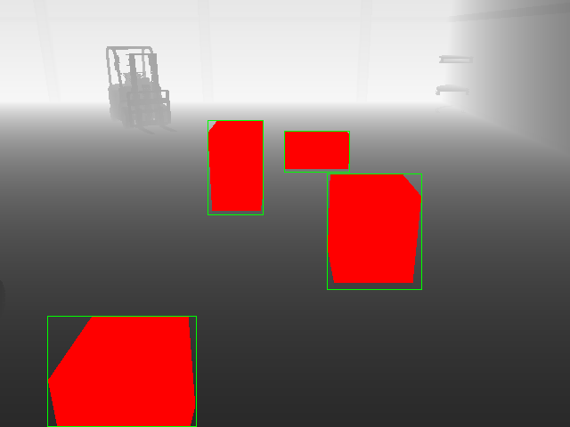
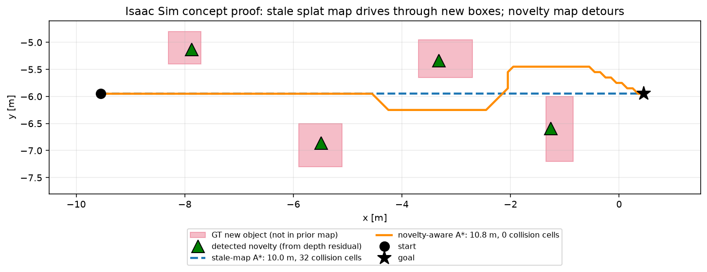
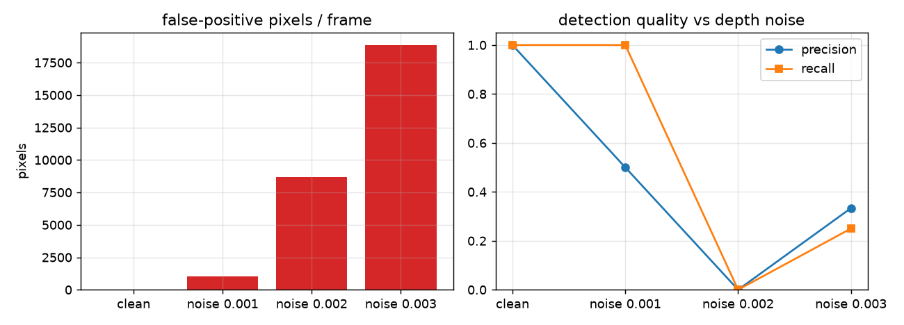

# Isaac Sim concept proof: novelty detection against a prior splat map (results)

**Date:** 2026-11-26. **Goal:** prove the G2 pipeline end-to-end in Isaac Sim before committing a thesis.
**Verdict: results obtained.** The pipeline (prior map → live RGB-D → novelty detection → planning) works:
**4/4 new objects detected with precision 1.00 / recall 1.00 and 0 false-positive pixels**, and the planner
goes from **32 collision cells** on the stale map to **0** with the novelty layer.

---

## 1. Experiment setup

| | |
|---|---|
| Prior map | empty warehouse captured from **72 viewpoints** (640×480 RGB-D + poses, camera at 2.45 m, 20° down) and a 200k-Gaussian gsplat trained on the flyover data (`runs/splat_flycam/final`) |
| Live scene | the same warehouse from the **same 72 viewpoints**, now with **4 new static boxes** (0.6×0.6×0.8, 0.8×0.8×1.0, 1.0×0.7×1.2, 0.5×1.2×0.7 m) not present in the prior map |
| Novelty test | live depth nearer than the prior observation by `τ = max(0.15 m, 0.03·z)` → back-project → 2D connected components |
| Planner | A* on a 10 cm grid, robot radius 0.35 m; collision = path cell inside a GT box footprint inflated by the robot radius |

Scripts: `scripts/capture_novelty_live.py` (live pass and `--empty` prior pass),
`scripts/splat/novelty_depth_prior.py` (detection + threshold sweep + noise sensitivity),
`scripts/novelty_nav_eval.py` (stale-vs-novelty planning).

## 2. Detection results (noise-free)

| Metric | Value |
|---|---|
| new objects detected | **4 / 4** |
| precision (clusters vs GT) | **1.00** |
| recall (GT covered) | **1.00** |
| false-positive pixels per frame | **0** |
| GT footprint coverage | 100 %, 100 %, 99 %, 97 % |
| per-frame detection rate (frames where visible) | 0.66 (multi-frame accumulation is what yields 4/4) |
| threshold sweep (τ = 0.07 … 0.45 m) | precision 1.00, recall 1.00 at every threshold |



*Left: the live scene with the 4 boxes. Overlay: novelty pixels (red) land exactly on the new boxes;
green rectangles are the simulator GT projections.*

## 3. Planning results

| Planner | Path length | Collision cells (GT) |
|---|---|---|
| stale prior map (splat map only) | 10.00 m | **32** |
| prior map + novelty layer | 10.84 m | **0** |

The stale map drives straight through four boxes; the novelty-aware map detours around them for +8 %
path length.



## 4. Noise sensitivity (why calibration is the actual thesis claim)

Adding depth noise `σ = k·z²` to the live depth:

| noise k | FP pixels/frame | P (default τ) | R (default τ) | best threshold in sweep |
|---|---|---|---|---|
| 0 | 0 | 1.00 | 1.00 | any τ ∈ [0.07, 0.45] |
| 0.001 | 1 009 | 0.50 | 1.00 | τ = 0.45 → P 1.00, R 1.00 |
| 0.002 | 8 669 | 0.00 | 0.00 | τ = 0.30 → P 0.38, R 0.75 |
| 0.003 | 18 856 | 0.33 | 0.25 | τ = 0.45 → P 0.67, R 1.00 |



Clean data is trivially perfect; as soon as realistic depth noise appears, the threshold determines the
false-positive/false-negative trade-off and a fixed threshold is unstable. This is exactly the gap G2
claims: **a calibrated, guarantee-carrying threshold rather than a hand-picked one** (the formal split
conformal calibration is the thesis work; the sweep above is the empirical calibration curve).

## 5. Honest negative result: rendering the splat from novel viewpoints

The first attempt detected novelty by **rendering the prior splat** at the live poses. It failed:

- 2 092 510 residual points → 521 clusters, precision 0.00, recall 0.25;
- reason: the splat render from poses outside its capture path is noisy (floaters, depth errors), so
  residual noise swamps the real change.

This is a useful finding for the thesis: a splat map alone is not reliable enough as a depth reference at
novel viewpoints, and the system should either (a) store depth observations with the map, (b) improve the
splat (more iterations/views, NuRec/GaussGym-style rendering), or (c) calibrate the render-error distribution.
The successful run used (a): the prior map stores the empty-warehouse depth observations from the same 72
viewpoints — a fair map-vs-reality test, and the same information a real robot's map would contain.

## 6. Limitations / next steps

- Prior = same 72 viewpoints, not a general re-localisation into a prior map; localisation-error injection is
  the next experiment (perturb pose before comparison).
- Single scenario, static boxes, no removed objects (negative change) and no dynamic actors yet.
- Planner is A* on a 2D grid, not the RL walker; the walker integration is the next pipeline stage.
- Formal calibration (split conformal over multiple episodes, false-safe rate per metre) is not done here.

**Reproduce:**

```powershell
C:\isaac-sim\python.bat scripts\capture_novelty_live.py                       # live scene with boxes
C:\isaac-sim\python.bat scripts\capture_novelty_live.py --empty --out C:\per\thesis\runs\novelty_proof\prior
.venv\Scripts\python.exe scripts\splat\novelty_depth_prior.py                 # detection + sweep
.venv\Scripts\python.exe scripts\novelty_nav_eval.py                          # stale vs novelty planning
```

Artifacts: `runs/novelty_proof/` (live frames, prior frames, `analysis/` with `planning_eval.json`,
`depth_prior_detections.json`, overlays, figures).
