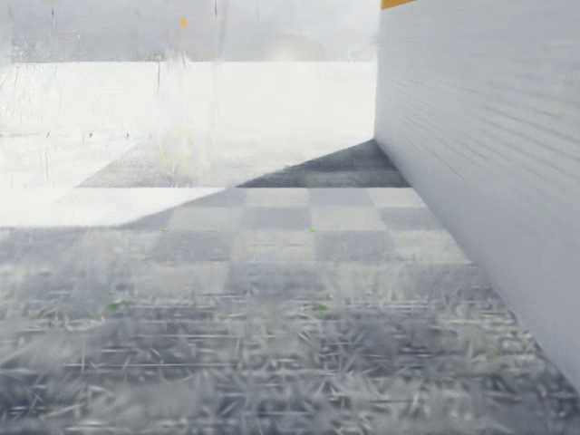

# Gaussian splat of the Isaac Sim warehouse (NVIDIA gsplat, no COLMAP)

## What was made

A walkthrough capture of the **entire warehouse** and a Gaussian-splat reconstruction trained with
**NVIDIA's gsplat** CUDA rasterizer — no COLMAP anywhere:

```
Isaac Sim warehouse (24 x 39 m, forklifts, racks, conveyors)
   │  capture_warehouse_walkthrough.py: A*-planned coverage route (~150 m), 212 RGB-D frames,
   │  exact camera poses + intrinsics from the simulator (no SfM needed)
   ▼
gsplat:25.10 container (nvcr.io/nvidia/pytorch:25.10-py3 + gsplat 1.5.3)
   │  train_gsplat_warehouse.py: depth back-projection → 200k Gaussians, 15 000 iters of 3DGS
   ▼
runs/warehouse_splat/final/
    warehouse_splat.ply                 200 000 Gaussians (standard 3DGS PLY)
    warehouse_splat_walkthrough.mp4     212 poses along the walkthrough (20 fps, 10.6 s)
    warehouse_splat_flythrough.mp4      slerp-interpolated flythrough (reference)
    pose_*.png                          stills
```

## Numbers

| | |
|---|---|
| frames | 212 RGB-D, 640x480, 0.7 m spacing, 150 m coverage route |
| Gaussians | 400k back-projected init → **200k** after 0.04 m voxelisation |
| training | 15 000 iterations, one random view/iter, L1+SSIM |
| final loss | **0.0362** (from 0.085 at 500 iters) |
| GPU | RTX A5000 Laptop 16 GB, ~0.04 s/iter, ~10 min total |

## How it works (and the traps)

1. **Poses**: the capture records each camera's world pose from Isaac Sim. The captured rotation is
   in the camera's optical convention (forward = +X, up = +Z), while gsplat needs OpenCV
   (x right, y down, z forward): `R_cv = R[:, [1,2,0]]` with the y and z axes negated — see
   `prim_to_cv()` in `train_gsplat_warehouse.py`.
2. **Initialisation** comes from metric depth (back-projected, voxel-downsampled) instead of a sparse
   SfM point cloud.
3. **gsplat expects activated values**: `sigmoid(opacity)`, `exp(scale)`, normalised quaternions,
   clamped colours. Passing raw log-scale/logit parameters silently renders nothing (the first
   attempts produced an all-black video and loss stuck at 0.82).
4. The capture camera must be **outside the robot mesh** (0.45 m forward offset) and the warehouse
   needs a **dome light**; otherwise frames are black.
5. Rendering at the recorded poses gives a clean walkthrough; slerp-interpolated poses show fog,
   because 200k semi-transparent Gaussians from depth init are not fully pruned.

## Viewing

- Video: `runs/warehouse_splat/final/warehouse_splat_walkthrough.mp4`.
- Splat: `runs/warehouse_splat/final/warehouse_splat.ply` — loads in any 3DGS viewer
  (SuperSplat, gsplat viewer, Blender's 3DGS add-ons, Isaac Sim's `omni.kit.converter.gsplat`).
- Isaac Sim's NVIDIA gsplat converter extension (`omni.kit.converter.gsplat`) can turn the PLY into a
  USD asset for the GUI.

## Reproduce

```powershell
# 1. walk the warehouse and capture RGB-D + poses
C:\isaac-sim\python.bat scripts\capture_warehouse_walkthrough.py

# 2. train with NVIDIA gsplat (nvcr pytorch 25.10 + gsplat)
docker build -f tools\vggt-slam\Dockerfile.gsplat -t gsplat:25.10 tools\vggt-slam
docker run --rm --gpus all --ipc=host ^
  -v C:\per\thesis\runs\warehouse_splat:/data ^
  -v C:\per\thesis\r1-isaaclab\scripts\splat:/code ^
  -v C:\per\thesis\gsplat_cache:/root/.cache/torch_extensions ^
  -e TORCH_CUDA_ARCH_LIST=8.6 gsplat:25.10 ^
  python /code/train_gsplat_warehouse.py --frames /data/frames --meta /data/walk_meta.json ^
  --out /data/final --iters 15000 --voxel 0.04 --max-points 200000

# 3. render the walkthrough at the recorded poses
docker run --rm --gpus all --ipc=host ^
  -v C:\per\thesis\runs\warehouse_splat:/data ^
  -v C:\per\thesis\r1-isaaclab\scripts\splat:/code gsplat:25.10 ^
  python /code/render_splat_walkthrough.py --model /data/final/gsplat_model.npz ^
  --meta /data/walk_meta.json --out /data/final
```

## Flyover capture (clean data, no robot, no markers)

The first walkthrough had two data problems: the velocity-command **arrows** that Isaac Lab draws above
the robot appeared in some frames, and the robot itself (plus its shadow) polluted others.
`scripts/capture_warehouse_flycam.py` fixes both:

- the velocity-command debug visualisation is disabled (`base_velocity.debug_vis = False`),
- the robot is made **invisible** in the stage (it only carries the camera mount),
- the camera rides at **2.45 m** on a serpentine coverage path through the free floor
  (216 frames, 640x480, RGB + metric depth + exact poses).

Training on that data with the same gsplat recipe gives a cleaner reconstruction:

| | walkthrough capture | flyover capture |
|---|---|---|
| frames | 212 | 216 |
| Gaussians | 200k | 200k |
| final loss (L1+SSIM) | 0.0362 | **0.0230** |
| video | `runs/warehouse_splat/final` | `runs/splat_flycam/final` |

Deliverables of the flyover version:

```
runs/splat_flycam/final/warehouse_splat.ply                  200k Gaussians
runs/splat_flycam/final/warehouse_splat_walkthrough.mp4      216 poses along the fly path
runs/splat_flycam/final/view_*.png                           stills
```



This is now the preferred capture mode for building a warehouse splat: free camera, hidden robot,
no debug markers.

