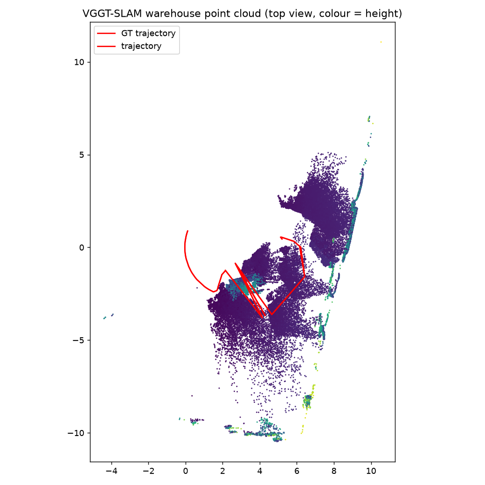

# VGGT-SLAM 2.0 on the Isaac Sim warehouse

Build: reproducible Docker image (Python 3.11 + torch 2.3.1 + GTSAM develop + SALAD + the MIT-SPARK
VGGT fork), because VGGT-SLAM 2.0 pins those versions and the Windows host has neither 3.11 nor a
compatible GTSAM wheel.

| file | role |
|---|---|
| `tools/vggt-slam/` | clone of MIT-SPARK/VGGT-SLAM (2.0, January 2026) |
| `tools/vggt-slam/Dockerfile.vggt` | python:3.11-slim + torch 2.3.1 cu121 + GTSAM develop wheel + SALAD + VGGT_SPARK |
| `tools/vggt-slam/Dockerfile.vggt-libs` | adds EGL/GL, libusb, libtbb for open3d (headless) |
| `r1-isaaclab/scripts/capture_warehouse_frames.py` | renders a curved 40-frame pass through the forklift warehouse from Isaac Sim, with GT camera poses |
| `r1-isaaclab/scripts/eval_vggt_warehouse.py` | Sim(3)-aligned ATE against the GT poses + point-cloud diagnostics |

## How the pieces fit

```
Isaac Sim warehouse --capture_warehouse_frames--> 40 RGB frames + GT poses (meta.json)
        |
        v
  vggt-slam:2.0 container  python main.py --image_folder /data/vggt_warehouse --log_results
        |
        v
  /out/poses.txt (per-frame camera pose) + /out/poses_points.pcd (dense map)
        |
        v
  eval_vggt_warehouse.py -> ATE RMSE, trajectory plot, top-down map
```

Notes learned while building it:

- the container's Python **must be 3.11**: `gtsam-develop` only publishes cp311/cp312 wheels;
  the official pytorch 2.3.1 image is Python 3.10.
- `gtsam-develop` is not on the corporate mirror; the cp311 wheel is downloaded on the host and
  copied into the image.
- open3d needs `libEGL`, `libusb-1.0`, `libtbb` even when headless.
- SALAD loop-closure retrieval needs `dino_salad.ckpt` (335 MB) in `torch.hub` checkpoints;
  VGGT-1B weights are 4.68 GB from `facebook/VGGT-1B`.
- the capture camera must be **outside the robot mesh** (offset 0.45 m forward) and the warehouse
  needs a dome light; camera poses need `update_latest_camera_pose=True`.

## Results

Run command (detached, weights cached after the first run):

```powershell
docker run --rm --gpus all --shm-size=8g ^
  -v C:\per\thesis\data:/data -v C:\per\thesis\runs\vggt:/out ^
  -v C:\per\thesis\hf_cache:/hf -v C:\per\thesis\torch_cache:/root/.cache/torch ^
  vggt-slam:2.0-libs python main.py --image_folder /data/vggt_warehouse2 ^
  --max_loops 1 --log_results --log_path /out/poses2.txt
```

| capture | frames | submaps | loop closures | poses out | Sim(3) scale | ATE RMSE | ATE max | point cloud |
|---|---|---|---|---|---|---|---|---|
| tight loop, r = 1.6 m | 40 | 2 | 0 | 25 | 3.79 | **0.228 m** | 0.766 m | 844 k points, 3 m span |
| wide loop, r = 2.6 m | 70 | 3 | 0 | 49 | 4.47 | 0.918 m | 2.772 m | 2.81 M points, 15 x 22 m |

Inference itself is fast once the weights are cached: 70 frames at ~4.3 FPS (3 submaps) in ~10 s on
the RTX A5000; the 4.68 GB VGGT-1B download was the long part.



Findings:

- VGGT-SLAM 2.0 runs end to end on Isaac Sim warehouse imagery and produces a dense metric-ish map
  plus per-frame poses; after an optimal Sim(3) alignment the tight 40-frame loop reaches **0.23 m
  ATE**, which is a usable map for planning.
- The wider 70-frame loop covers much more of the warehouse (15 x 22 m, 2.8 M points) but drifts
  (0.92 m ATE): **no loop closures were detected** (`lc_thres = 0.95` and our capture never revisits
  a view for SALAD), so the three submaps are stitched without global correction.
- The scale is arbitrary (3.8 / 4.5) as expected for a monocular feed-forward reconstruction; a robot
  needs the metric scale from odometry/IMU or a known-size landmark.
- Capture quality matters more than inference settings: light the warehouse (dome light), keep the
  camera outside the robot mesh, and move with rotation (a curved path) rather than straight lines.

## DeltaSplat

`DeltaSplat` (arXiv 2610.09853, "Iterative Gaussian Refinement for Pose-Free Feed-Forward 3D Gaussian
Splatting") has **no public code** as of this build: the arXiv page has no code link and a GitHub
search returns only paper collections / awesome lists. It is a ~2.2 %-parameter residual refiner on
top of a pose-free feed-forward 3DGS backbone; reproducing it means implementing the dual-branch
residual mixer (Pl?cker rays + rendered depth + RGB residual) on a backbone such as VGGT/GS-LRM.
That is a research-grade implementation, not a config. The existing local splat trainer
(`scripts/splat/splat_taichi.py`) can serve as the backbone for such a refiner later.

Next steps if we continue:

1. Lower `lc_thres` and capture trajectories that revisit views so VGGT-SLAM's loop closure fires,
   which should cut the 70-frame drift.
2. Feed VGGT-SLAM's point cloud into the occupancy-map/A* pipeline (`r1_isaaclab/warehouse.py`) so the
   warehouse navigation uses the reconstructed map instead of ground-truth colliders.
3. Multi-session mapping: add a second capture pass and check map alignment against the first.

